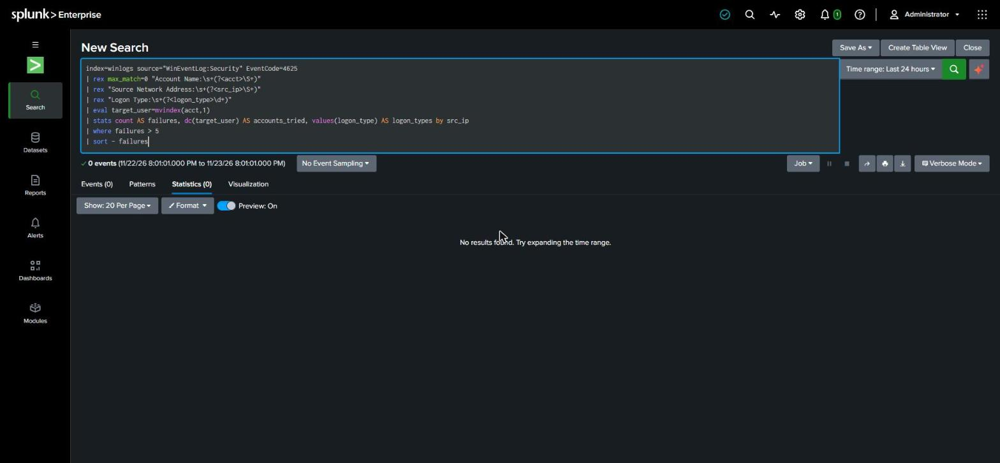
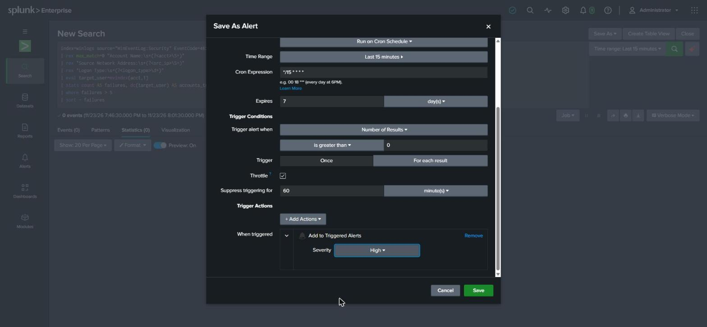
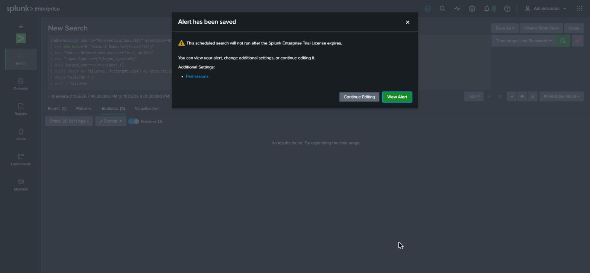
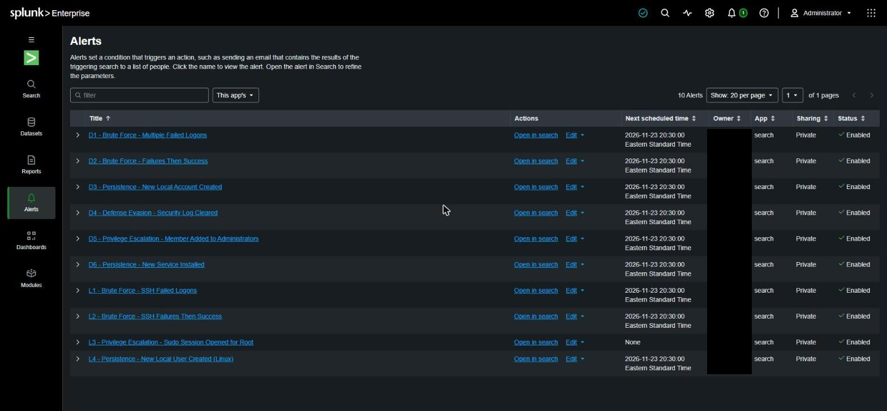
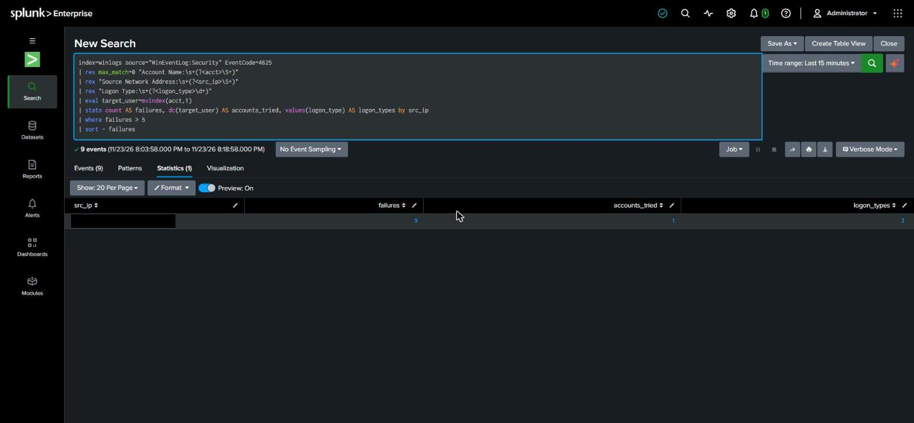
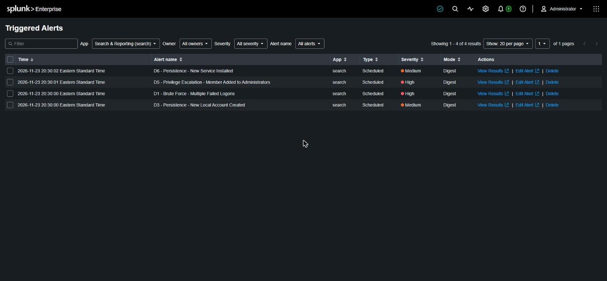

# 06 - Scheduled alerts

**Time:** about 90 minutes for all ten alerts. Detections only matter in a SOC if they run on their own and put something in front of an analyst, so I converted my saved detections (D1-D6, L1-L4) into scheduled alerts and tested them with simulated attacks on my own lab systems.

> **Lab only.** Every event below was generated by me on my own machine and my own VMs, using throwaway test accounts that I removed afterwards.

## Before you start: licensing

Splunk Free cannot run scheduled alerts. This lab runs on the Splunk Enterprise **trial** license (Settings > Licensing shows the expiration date; mine runs to January 2027). When I saved the first alert, Splunk warned me that the scheduled search will stop running once the trial license expires. Take your screenshots while the trial is active.

## The alert set

| Alert | Detection | MITRE ATT&CK | Severity | Source |
|---|---|---|---|---|
| D1 - Brute Force - Multiple Failed Logons | More than 5 failed logons from one source | T1110 Brute Force | High | Windows |
| D2 - Brute Force - Failures Then Success | More than 3 failures plus a success for one account | T1110 / T1078 Valid Accounts | High | Windows |
| D3 - Persistence - New Local Account Created | Event 4720 | T1136.001 Local Account | Medium | Windows |
| D4 - Defense Evasion - Security Log Cleared | Event 1102 | T1070.001 Clear Windows Event Logs | Critical | Windows |
| D5 - Privilege Escalation - Member Added to Administrators | Event 4732 on the Administrators group | T1098 Account Manipulation | High | Windows |
| D6 - Persistence - New Service Installed | Event 7045 | T1543.003 Windows Service | Medium | Windows |
| L1 - Brute Force - SSH Failed Logons | More than 3 failed SSH passwords from one source | T1110 Brute Force | High | Linux |
| L2 - Brute Force - SSH Failures Then Success | More than 3 failures plus a success for one user and source | T1110 / T1078 Valid Accounts | High | Linux |
| L3 - Privilege Escalation - Sudo Session Opened for Root | Sudo to root, cron excluded | T1548.003 Sudo and Sudo Caching | Medium | Linux |
| L4 - Persistence - New Local User Created (Linux) | New user, service accounts excluded | T1136.001 Local Account | Medium | Linux |

The search behind each alert is the same SPL as in `queries/04-detections-windows.spl` and `queries/06-detections-linux.spl`. I did not change the detection logic, only how it runs. The alert names start with the detection ID so the queue sorts the same way as the docs, followed by a tactic and the behavior.

I did not turn D7 (failed logon spike chart), W1 and W2 (web) into alerts. D7 is a trend view for the dashboard, and W2 is a ranking, not a threshold rule.

## Settings shared by every alert

| Setting | Value | Why |
|---|---|---|
| Alert type | Scheduled, **Run on Cron Schedule** | I want a predictable run time |
| Cron expression | `*/15 * * * *` | Runs at :00, :15, :30 and :45 |
| Time range | Last 15 minutes | Matches the schedule so each event is checked once |
| Trigger condition | Number of Results is greater than 0 | The SPL already applies the threshold with `where` |
| Trigger | For each result | One alert per source or account, not one blob |
| Throttle | Suppress for 60 minutes | Stops the same activity from flooding the queue |
| Expires | 7 days | How long a triggered alert stays in the queue |
| Trigger action | Add to Triggered Alerts | The queue an analyst works from |

Severity follows the impact: a cleared audit log is **Critical**, credential attacks and admin changes are **High**, and persistence and sudo are **Medium** because they have more legitimate causes.

## Create an alert (example: D1)

1. In **Search & Reporting**, set the time picker to **Last 15 minutes** and run the D1 query from `queries/04-detections-windows.spl`.
2. Click **Save As > Alert**.
3. **Title:** `D1 - Brute Force - Multiple Failed Logons`. **Description:** the ATT&CK technique, the threshold, and the first triage step.
4. **Alert type:** Scheduled, then choose **Run on Cron Schedule** in the dropdown and enter `*/15 * * * *`.
5. **Expires:** 7 days.
6. **Trigger alert when:** Number of Results, is greater than, 0. **Trigger:** For each result.
7. Tick **Throttle** and set **Suppress triggering for** 60 minutes.
8. **Add Actions > Add to Triggered Alerts**, then set **Severity** to High.
9. Click **Save**.







I repeated the same steps for D2-D6 and L1-L4, changing only the title, description and severity. Time zone note: Splunk shows times in my local time (Eastern).

**Verify:** all ten alerts are listed under **Alerts** (or **Settings > Searches, reports, and alerts**) with a next scheduled time.



## Test the alerts with simulated activity

I ran these from an elevated PowerShell window in the repo folder. Scripts are blocked by default on Windows, so I allowed them for that one window only:

```powershell
Set-ExecutionPolicy -Scope Process -ExecutionPolicy Bypass -Force
```

| Alert | What I ran | What it generates |
|---|---|---|
| D1 | `.\scripts\generate-failed-logons.ps1 -User alertuser -Attempts 8` | Event 4625 failed logons |
| D3 | `.\scripts\create-lab-user.ps1 -User alertuser` | Event 4720 new account |
| D2 | `.\scripts\generate-successful-logon.ps1 -User alertuser` | Event 4624 after the failures |
| D5 | `Add-LocalGroupMember -Group "Administrators" -Member alertuser` | Event 4732 |
| D6 | `sc.exe create LabTestSvc binPath= "C:\Windows\System32\cmd.exe /c echo lab" start= demand` | Event 7045 |

I did not re-test D4 live because that means clearing my own Security log. It is covered by the manual test in `04-detections.md`.

Before the scheduled run, I confirmed that Splunk had indexed the failed logons by running D1 over the last 15 minutes: it returned the source with 9 failed logons (the 8 from the script plus one from an earlier step), above the threshold of 5. The source address is redacted in the screenshot.



## Result: what fired

At the 8:30 PM scheduled run, four alerts appeared in **Activity > Triggered Alerts**: D1 (High), D3 (Medium), D5 (High) and D6 (Medium). Each one triggered within two seconds of the scheduled time.



| Alert | Fired at 8:30 PM? | Notes |
|---|---|---|
| D1 | Yes | Failed logons fell inside the 15 minute window |
| D3 | Yes | New local account created |
| D5 | Yes | Account added to Administrators |
| D6 | Yes | Test service installed |
| D2 | No | I have not confirmed why yet. I need to check whether the failures and the success fell inside the same 15 minute window and whether the query's conditions matched |
| D4, L1-L4 | No | Not expected: I did not clear the log, and the Linux VMs were not generating traffic during this test |

Not every alert firing is itself a result. The D2 miss is a good tuning exercise: I would run the D2 query over a wider time range to see whether it matches, and then decide whether the window or the logic needs to change.

## Clean up

When testing is finished, remove everything I created:

```powershell
sc.exe delete LabTestSvc
Remove-LocalGroupMember -Group "Administrators" -Member alertuser
.\scripts\remove-lab-user.ps1 -User alertuser
```

## Lessons learned

- **The time range is part of the alert.** The alert uses the time range the search had when I saved it. I first had the picker on 24 hours, so I reloaded the search on **Last 15 minutes** before saving, otherwise every run would have re-counted a whole day of events.
- **Schedule and window should match.** A 15 minute schedule with a 15 minute window checks each event once. A longer window would re-trigger on old events, which throttling then hides.
- **Throttle on purpose.** Without it, one noisy source creates a new alert every 15 minutes. With it, the analyst sees one alert and can look at the trend in Search.
- **Scripts need an execution policy.** The lab scripts did not run until I allowed scripts in that window.
- **Alerts only see what Splunk has indexed.** If an event has not arrived yet, the alert misses it, which is one more reason to check ingestion first when an expected alert does not fire.

## Checkpoint

- [ ] Ten alerts show as scheduled in **Alerts**
- [ ] Simulated activity ran and the matching detections return results
- [ ] Triggered alerts appear in **Activity > Triggered Alerts**
- [ ] Test account, admin membership and service removed
